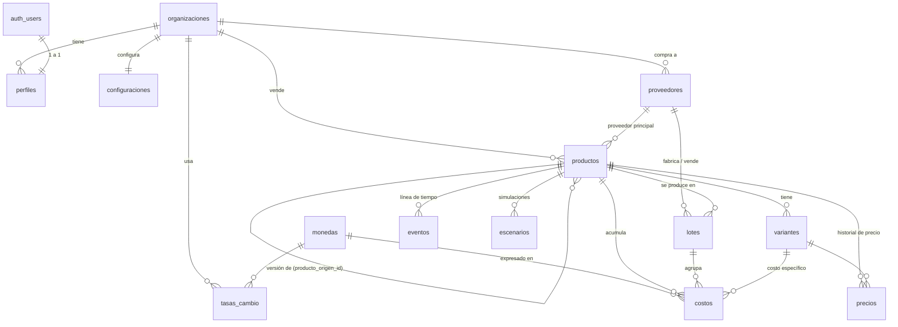

# 2. Modelo de datos

El SQL completo (tablas, enums, triggers, RLS y Storage) está en
[`supabase/migrations/0001_esquema_inicial.sql`](../supabase/migrations/0001_esquema_inicial.sql).
Todas las tablas viven en el schema **`martha`** (p. ej. `martha.productos`); el proyecto de Supabase puede ser compartido con otras apps.

## 2.1 Diagrama entidad-relación

## 2.2 Tablas

| Tabla | Propósito | Campos clave |
|---|---|---|
| `organizaciones` | Empresa / tienda (multi-tenant). | `nombre` |
| `perfiles` | Espejo de `auth.users.app_metadata` dentro de una organización (lo mantiene el trigger `sincronizar_perfil`). | `rol` (`admin`, `colaborador`), `activo` |
| `configuraciones` | Márgenes y costos de venta por defecto. | `margen_minimo`, `margen_objetivo`, `comision_canal_pct`, `pasarela_pct` |
| `monedas` | Catálogo ISO (COP, USD, EUR, CNY, MXN). | `codigo`, `simbolo`, `decimales` |
| `tasas_cambio` | Histórico de tasas a COP. | `moneda`, `tasa_cop`, `fecha`, `fuente` |
| `proveedores` | Proveedores nacionales e internacionales. | `pais`, `tipo`, `moneda` |
| `productos` | Ficha del producto + parámetros de cálculo. | `sku`, `categoria`, `estado`, `moneda_base`, `unidades_estimadas`, `base_asignacion`, `precio_venta`, costos de venta, `producto_origen_id`, `version` |
| `variantes` | Talla, color, material, presentación… | `atributos` (jsonb), `costo_adicional_unitario`, `precio_venta` |
| `lotes` | Producción, compra o importación. | `tipo`, `estado`, `unidades_estimadas`, `unidades_reales` |
| `costos` | Cada gasto asociado al producto (y opcionalmente a un lote o variante). | `categoria`, `tipo`, `moneda`, `modo`, `valor`, `valor_real`, `cantidad_unidades`, `tasa_cambio`, `estado`, `causa_diferencia`, `comprobante_url` |
| `precios` | Historial de precios (se llena por trigger). | `precio`, `fecha`, `motivo` |
| `eventos` | Línea de tiempo: creación, muestras, compras, importación, lanzamiento, cambios. | `tipo`, `descripcion`, `datos` (antes/después) |
| `escenarios` | Escenarios guardados del simulador. | `parametros` (jsonb) |

### Enumeraciones

- **Categoría de costo** → grupo de cálculo:

| Categoría | Etiqueta | Grupo |
|---|---|---|
| `materia_prima` | Materia prima / costo del producto | Producto |
| `mano_obra` | Mano de obra | Producto |
| `empaque` | Empaque primario y secundario | Producto |
| `etiquetas` | Etiquetas, hangtags, certificados, autenticidad | Producto |
| `flete` | Flete internacional o nacional | Llegada (landed) |
| `seguro` | Seguro de carga | Llegada |
| `aduana` | Aranceles, IVA de importación, gastos aduaneros | Llegada |
| `agente_aduanas` | Agente de aduanas / brokerage | Llegada |
| `almacenamiento` | Almacenamiento y logística (manejo) | Llegada |
| `desarrollo` | Diseño, muestras, desarrollo, prototipos | Indirecto |
| `creativo` | Fotografía, contenido, producción creativa | Indirecto |
| `otro` | Otros personalizables | Indirecto |
| `comisiones_venta` | Comisiones de canal, pasarela, publicidad, distribución | Venta |

- **Tipo de costo**: `variable` (se divide entre las unidades del lote o del costo), `fijo`, `unico`, `recurrente` (se asignan entre las unidades base del producto).
- **Estado del costo**: `estimado`, `pendiente`, `pagado`, `ajustado`.
- **Causa de diferencia**: `flete`, `impuestos`, `cambio_proveedor`, `merma`, `reproceso`, `tasa_cambio`, `otro`.

### Usuarios y seguridad

- `app` (= `'martha'`), `organizacion_id`, `rol` y `activo` viven en `auth.users.raw_app_meta_data` (app_metadata), que solo se puede escribir con la service role. La función `martha.sincronizar_perfil` (triggers `martha_on_auth_user_created` y `martha_on_auth_user_app_metadata`) hace *upsert* en `martha.perfiles` **solo si `app = 'martha'`**; para usuarios de otras apps sale sin hacer nada. No crea organizaciones.
- `organizacion_id` se completa en cada insert con el trigger `martha_fijar_organizacion` (función `martha.fijar_organizacion`).
- `martha.mi_organizacion()` y `martha.es_admin()` (security definer, `search_path` vacío) leen `martha.perfiles` y solo consideran perfiles **activos**.
- Los usuarios autenticados solo pueden actualizar la columna `nombre` de su propio perfil (privilegio de columna + política `perfiles_propio`).

## 2.3 Reglas de cálculo (motor `src/lib/calculos`)

Notación: todos los valores se convierten a COP con la `tasa_cambio` congelada del costo (o la tasa vigente si no tiene).

0. Notación adicional: *unidades de lotes* = Σ unidades (reales si existen, si no estimadas) de los lotes del producto que tienen costos variables.
1. **Valor total de un costo** = `valor_real ?? valor` × (`cantidad_unidades` si `modo = unitario`) × tasa.
2. **Unidades base de asignación** = `unidades_estimadas` del producto, o la suma de `unidades_reales` de sus lotes si `base_asignacion = producidas`.
3. **Costo por unidad de un costo**
   - `variable` con lote → total / unidades de lotes (con varios lotes queda el promedio ponderado; la merma sube el costo real).
   - `variable` sin lote → total / `cantidad_unidades`.
   - `fijo` · `unico` · `recurrente` → total / unidades base.
4. **Costo directo unitario** = Σ costos del grupo *Producto*.
5. **Costos logísticos e importación por unidad** = Σ grupo *Llegada*.
6. **Landed cost** = costo del producto + flete + aduana + seguros + manejo + otros costos de llegada.
7. **Costos fijos asignados por unidad** = Σ costos no variables / unidades base.
8. **Costo total por unidad** = landed cost + costos indirectos por unidad.
9. **Costos de venta por unidad** = precio × (comisión % + pasarela %) + publicidad + envío al cliente + otros + Σ grupo *Venta*.
10. **Margen bruto** = (precio − costo total unitario) / precio.
11. **Margen neto** = (precio − costo total unitario − costos de venta) / precio.
12. **Precio para un margen neto m** = (costo total unitario + costos de venta fijos por unidad) / (1 − comisión% − pasarela% − m). Si el denominador ≤ 0 el margen es inalcanzable.
    - **Precio mínimo** = precio para el margen mínimo.
    - **Precio sugerido** = precio para el margen objetivo (30 %, 40 %, 50 % o personalizado).
    - **Precio de equilibrio por unidad** = precio para margen 0.
13. **Punto de equilibrio por lote** = inversión del lote / (precio − costos de venta por unidad), redondeado hacia arriba.
14. **Semáforo**: verde si margen neto ≥ mínimo; amarillo si 0 ≤ margen < mínimo; rojo si hay pérdida.
15. **Estimado vs. real (lote)**: Σ `valor` vs. Σ `valor_real ?? valor`; costo unitario estimado = estimado / unidades estimadas; real = real / unidades reales. Diferencias agrupadas por `causa_diferencia`.

## 2.4 Ejemplo trabajado (faja colombiana, lote de 500 u.)

| Costo | Tipo | Total | Por unidad |
|---|---|---:|---:|
| Tela powernet y forro | variable | $ 11.000.000 | $ 22.000 |
| Confección (taller satélite) | variable | $ 7.500.000 | $ 15.000 |
| Broches, varillas, cremallera | variable | $ 2.250.000 | $ 4.500 |
| Empaque + etiquetas | variable | $ 2.000.000 | $ 4.000 |
| Flete nacional | variable | $ 600.000 | $ 1.200 |
| **Landed cost** | | | **$ 46.700** |
| Diseño, moldería, muestras (÷ 1.000 u. base) | único | $ 3.200.000 | $ 3.200 |
| Fotografía (÷ 1.000 u.) | único | $ 1.800.000 | $ 1.800 |
| **Costo total por unidad** | | | **$ 51.700** |

Con precio $ 189.000, comisión 10 % y pasarela 3,5 %, publicidad $ 18.000 y envío $ 12.000 por unidad:
costos de venta = $ 55.515 → margen bruto 72,6 %, margen neto 43,3 %.
