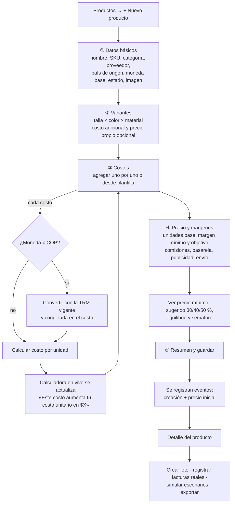
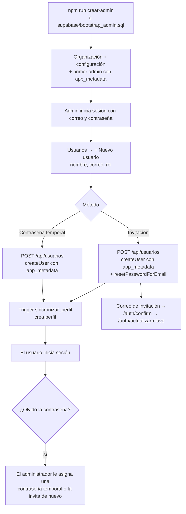

# 4. Flujo: registrar un producto desde cero y calcular su costo

## Paso a paso

| # | Paso | Qué hace el usuario | Qué hace Martha |
|---|---|---|---|
| 1 | **Datos básicos** | Escribe nombre («Faja colombiana clásica»), SKU, categoría «Fajas», elige proveedor, país y moneda base. | Valida SKU único; si el proveedor es internacional sugiere moneda USD. |
| 2 | **Variantes** | Marca tallas S–XL y colores negro/beige. Puede indicar que XL cuesta $ 2.000 más. | Genera las combinaciones con SKU `FAJ-CLA-001-NEG-S`, etc. |
| 3 | **Costos** | Agrega «Tela powernet», variable, COP, total $ 11.000.000, 500 u. | Muestra *«Este costo aumenta tu costo unitario en $ 22.000»* y recalcula landed cost, costo total y precios. Puede usar plantillas (faja nacional / importación) para no olvidar costos. |
| 4 | **Precio** | Define unidades base (1.000), margen mínimo 25 %, objetivo 40 %, comisión 10 %, pasarela 3,5 %, publicidad y envío por unidad, y su precio de venta. | Muestra precio mínimo, sugerido, equilibrio y el semáforo del precio elegido con la fórmula aplicada. |
| 5 | **Resumen** | Revisa y guarda. | Persiste producto, variantes, costos; registra eventos «Creación» y precio inicial. |
| 6 | **Después** | Crea el lote real, carga facturas (valor real + causa), simula escenarios, exporta PDF/Excel. | Compara estimado vs. real, ajusta el costo final y alimenta el dashboard. |

## Reglas de validación

- Nombre, SKU y categoría obligatorios; SKU único por organización.
- Un costo en moneda extranjera requiere tasa > 0 (se toma de Configuración y es editable).
- `cantidad_unidades` > 0; si es «unitario», el total = valor × unidades.
- Márgenes entre 0 % y 95 %; si comisiones + margen ≥ 100 % se advierte «margen inalcanzable».
- Precio de venta 0 permitido en borrador; el semáforo muestra «sin precio».

---

# Anexo: flujo de alta de usuarios (sin registro público)

- La ruta de servidor valida el token del llamante y que su perfil sea **admin activo** de la misma organización antes de usar la service role.
- Cambiar rol o desactivar: `PATCH /api/usuarios/{id}` → actualiza `app_metadata` (y `ban_duration` al desactivar); el trigger sincroniza `perfiles`.
